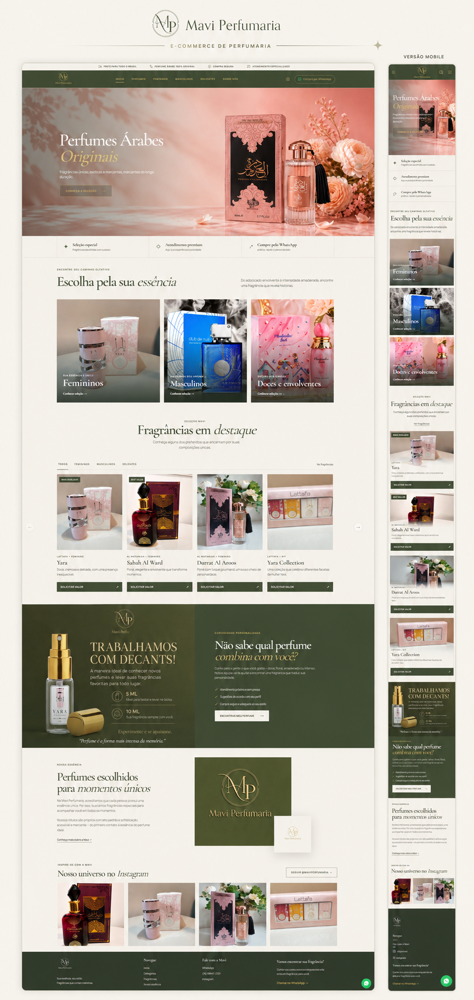

# Mavi Perfumaria

Landing page desenvolvida para a **Mavi Perfumaria**, especializada em perfumes árabes e decants. O projeto combina uma identidade visual elegante com uma navegação intuitiva, apresentando produtos e diferenciais da marca enquanto direciona o público para um atendimento personalizado pelo WhatsApp.

  <a href="https://perfumariamavi.vercel.app/" target="_blank">
    <strong>Visitar o site online ↗</strong>
  </a>

## Recursos implementados

- **HTML5** — estrutura semântica e acessível
- **CSS3** — layout responsivo, animações e identidade visual
- **JavaScript** — interações, filtros e carrosséis
- **Google Fonts** — tipografia Cormorant Garamond e Manrope
- **Vercel** — hospedagem e publicação do projeto

## Funcionalidades principais

- Carrossel de banners com navegação automática e manual
- Vitrine de fragrâncias com filtros por categoria
- Carrossel responsivo de produtos
- Links personalizados para atendimento e compra pelo WhatsApp
- Seções de categorias, produtos, consultoria, história da marca e Instagram
- Menu adaptado para dispositivos móveis
- Animações de entrada durante a navegação

## Destaques do desenvolvimento

- **Responsividade:** interface adaptada para desktop, tablet e dispositivos móveis, com imagens específicas para diferentes tamanhos de tela.
- **SEO:** metadados descritivos, URL canônica, Open Graph, dados estruturados em JSON-LD, `robots.txt` e `sitemap.xml`.
- **Performance:** carregamento tardio de imagens, dimensões de mídia definidas e priorização do banner principal.
- **Acessibilidade:** HTML semântico, textos alternativos, link para pular ao conteúdo, atributos ARIA e suporte a preferência por movimento reduzido.
- **Experiência do usuário:** navegação fluida, filtros de produtos, controles de carrossel, chamadas para ação claras e contato direto pelo WhatsApp.

## Autor

Desenvolvido por **Atawan Cazetta**.

[GitHub](https://github.com/atawancazetta)
